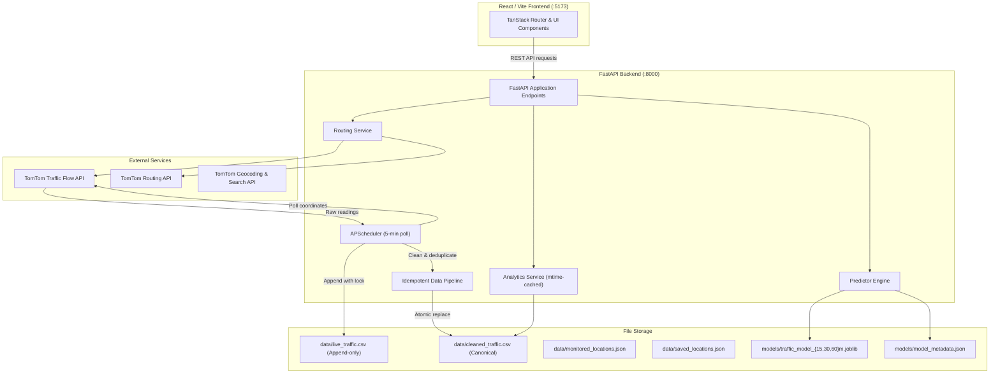

# TrafficWatch

**Real-Time Traffic Monitoring, Route Planning & Predictive Forecasting Platform**

TrafficWatch is an open-source urban mobility platform that collects live traffic flow telemetry, cleans and normalizes historical observations, provides multi-alternative route planning with delay calculations, and evaluates multi-horizon congestion forecasts using strict chronological machine learning.

Built with **FastAPI**, **React 19**, **TypeScript**, **Vite**, **scikit-learn**, and the **TomTom Traffic & Routing APIs**.

---

## Table of Contents

1. [Problem Statement](#1-problem-statement)
2. [Key Features](#2-key-features)
3. [User Interface & Visual Tour](#3-user-interface--visual-tour)
4. [Technology Stack](#4-technology-stack)
5. [System Architecture](#5-system-architecture)
6. [Data Pipeline: Collection, Cleaning & Storage](#6-data-pipeline-collection-cleaning--storage)
7. [Machine Learning & Predictive Methodology](#7-machine-learning--predictive-methodology)
8. [Prerequisites & Windows Installation](#8-prerequisites--windows-installation)
9. [Configuration & Environment Variables](#9-configuration--environment-variables)
10. [Running the Application](#10-running-the-application)
11. [Accessing the Interface & API Documentation](#11-accessing-the-interface--api-documentation)
12. [Automated Testing & Production Build](#12-automated-testing--production-build)
13. [Project Directory Structure](#13-project-directory-structure)
14. [Troubleshooting](#14-troubleshooting)
15. [Security & Data Handling](#15-security--data-handling)
16. [Contributing](#16-contributing)
17. [License](#17-license)
18. [Acknowledgements](#18-acknowledgements)

---

## 1. Problem Statement

Urban traffic congestion results in wasted commute hours, increased carbon emissions, and unpredictable travel schedules. While consumer navigation apps offer turn-by-turn guidance, researchers, city analysts, and developers frequently encounter significant limitations:

- **Data Volatility**: Raw traffic feeds are prone to transient dropouts, duplicate readings, and inconsistent spatial identifiers.
- **Opacity in Forecasting**: Most mapping services provide black-box arrival estimates without disclosing model assumptions, baseline comparisons, or prediction confidence.
- **Fragmented Workflows**: Municipal teams often manage separate tools for live corridor monitoring, historical bottleneck analysis, and multi-alternative route evaluation.

TrafficWatch addresses these challenges by integrating an automated telemetry collector, an idempotent data-cleaning pipeline, transparent machine learning forecasting benchmarks, and an interactive dashboard into a cohesive, locally deployable application.

---

## 2. Key Features

TrafficWatch implements eight dedicated feature views:

| Feature | Route | Capabilities |
| :--- | :--- | :--- |
| **Dashboard** | `/dashboard` | High-level system health overview, live corridor status cards, real-time leaflet map, and quick navigation shortcuts. |
| **Live Traffic** | `/live-traffic` | Real-time traffic flow map with color-coded speed segments, speed vs. free-flow comparisons, delay gauges, and corridor filtering. |
| **Route Planner** | `/route-planner` | Interactive origin-to-destination routing, computing up to 3 alternative routes with live travel times, traffic delays, congestion %, and route ranking (fastest, shortest, least congested). |
| **Congestion Hotspots** | `/hotspots` | Severity-ranked bottleneck identification across monitored corridors, categorizing delays into Low, Moderate, Heavy, and Severe. |
| **My Locations** | `/locations` | Bookmarking management for frequent places (Home, Work, Custom), featuring geocoded search and instant traffic flow inspection. |
| **Traffic Analytics** | `/analytics` | Historical analytics featuring summary statistics, hourly and day-of-week heatmaps, speed vs. delay scatter plots, road comparison charts, and filtered CSV dataset export. |
| **Predictions** | `/predictions` | Multi-horizon forecasts (15, 30, and 60 minutes) for monitored corridors, candidate model benchmark metrics (MAE, RMSE, MAPE), data freshness alerts, and minimum-sample safeguards. |
| **About & Data** | `/about` | System documentation, data pipeline metrics, active monitoring coverage, and architecture reference. |

---

## 3. User Interface & Visual Tour

> [!NOTE]
> Screenshots can be added to the `docs/screenshots/` folder. The placeholders below represent key views in the application.

```markdown
<!-- Screenshot Gallery Placeholders -->

### Dashboard & Live Map Overview

*High-level overview displaying city-wide traffic health, active bottlenecks, and interactive leaflet map.*

### Multi-Alternative Route Planner

*Traffic-aware routing comparing alternative paths, travel times, and congestion delays.*

### Historical Analytics & Congestion Heatmap

*Hourly and day-of-week congestion heatmaps with speed-delay correlation charts and CSV export.*

### Multi-Horizon Traffic Predictions

*15-, 30-, and 60-minute forecasts comparing candidate algorithms with live staleness indicators.*
```

---

## 4. Technology Stack

### Backend & Data Pipeline
- **Runtime & Web Framework**: Python 3.11–3.13, [FastAPI](https://fastapi.tiangolo.com/) (0.143.1)
- **ASGI Server**: [Uvicorn](https://www.uvicorn.org/) (0.54.0) with uvloop/httptools
- **Task Scheduler**: [APScheduler](https://apscheduler.readthedocs.io/) (3.11.3) with BackgroundScheduler
- **Data Engineering**: [Pandas](https://pandas.pydata.org/) (3.0.6), [NumPy](https://numpy.org/) (2.5.4)
- **Machine Learning**: [scikit-learn](https://scikit-learn.org/) (1.9.1), [Joblib](https://joblib.readthedocs.io/) (1.6.0)
- **Data Visualization**: [Matplotlib](https://matplotlib.org/) (3.11.2)
- **HTTP Client & Environment**: [Requests](https://requests.readthedocs.io/) (2.34.2), [python-dotenv](https://github.com/theskumar/python-dotenv) (1.2.4)
- **Backend Testing**: [pytest](https://pytest.org/) (9.1.1), [HTTPX](https://www.python-httpx.org/) (0.28.1)

### Frontend & Client
- **Runtime & Package Manager**: [Bun](https://bun.sh/) 1.4+ (or Node.js 20+)
- **UI Framework & Language**: [React](https://react.dev/) 19.2, [TypeScript](https://www.typescriptlang.org/) 5.8
- **Build Tool**: [Vite](https://vitejs.dev/) 8.1
- **Client Routing**: [@tanstack/react-router](https://tanstack.com/router) (1.170.41)
- **Server State & Caching**: [@tanstack/react-query](https://tanstack.com/query) (5.101.1)
- **Interactive Mapping**: [Leaflet](https://leafletjs.com/) (1.9.4), [react-leaflet](https://react-leaflet.js.org/) (5.0.0)
- **Charts & Visualizations**: [Recharts](https://recharts.org/) (2.15.4)
- **Component Primitives & Styling**: [Radix UI](https://www.radix-ui.com/), [Tailwind CSS](https://tailwindcss.com/) 4.2, [Lucide React](https://lucide.dev/) (0.575.0)
- **Frontend Testing**: [Vitest](https://vitest.dev/) 4.1, Testing Library (React 16.0)

---

## 5. System Architecture

TrafficWatch is structured as two independent tiers communicating over standard REST JSON interfaces:



For detailed component interaction diagrams and concurrency specifications, refer to [ARCHITECTURE.md](docs/ARCHITECTURE.md).

---

## 6. Data Pipeline: Collection, Cleaning & Storage

TrafficWatch operates a dual-tier storage strategy designed for reproducibility and data safety:

1. **Raw Append-Only Log (`data/live_traffic.csv`)**:
   - The background scheduler queries the TomTom Traffic Flow API every 5 minutes for each coordinate registered in `data/monitored_locations.json`.
   - Raw records are appended using thread-safe locking (`csv_lock`). Raw telemetry is never overwritten or deleted.
2. **Canonical Cleaned Store (`data/cleaned_traffic.csv`)**:
   - Incremental validation verifies coordinate bounds, non-negative speeds, travel times, and timestamps.
   - City names and corridor labels are standardized to prevent categorical fragmentation.
   - Two-stage deduplication eliminates exact byte duplicates and resolves logical duplicates within 60-second observation windows.
   - Conflicting readings are resolved in favor of the reading with higher TomTom sensor confidence.
   - Cleaned data is written via a temporary file (`.tmp`) and replaced atomically using `os.replace()`, preventing race conditions with concurrent reads.
3. **In-Memory Caching**:
   - Downstream analytics services inspect file modification timestamps (`getmtime`) on disk, serving cached calculations when the underlying CSV has not changed.

For complete schema details and validation rules, see [DATA_PIPELINE.md](docs/DATA_PIPELINE.md).

---

## 7. Machine Learning & Predictive Methodology

### Formulation & Feature Engineering
TrafficWatch forecasts congestion residual deltas ($\Delta_{t+h} = \text{Congestion}_{t+h} - \text{Congestion}_t$) across three horizons: **15 minutes**, **30 minutes**, and **60 minutes**. 

Features extracted include:
- Current congestion percentage, speed, free-flow speed, and free-flow gap.
- Cyclical temporal embeddings ($\sin$/$\cos$ transformations of hour of day and day of week).
- Antecedent corridor trends (`cong_trend`, `speed_trend`) computed strictly from prior observations.

### Leakage Prevention & Chronological Validation
To prevent temporal lookahead bias:
- Datasets are partitioned strictly chronologically: **60% Train**, **20% Validation**, and **20% Held-out Test**.
- Embargo boundary buffers ($\ge 60$ minutes) isolate partitions so that target forecast windows never span partition splits.
- All candidate models are benchmarked on the exact same chronological test records.

### Candidate Benchmarks & Baseline Optimality
During evaluation on the held-out test split:
- **Persistence Baseline** ($\widehat{\Delta} = 0$, projecting that current conditions persist over the short term):
  - **15m Test MAE**: **3.97%** (RMSE 7.38%, MAPE 37.22%)
  - **30m Test MAE**: **4.18%** (RMSE 7.39%, MAPE 39.42%)
  - **60m Test MAE**: **3.36%** (RMSE 6.78%, MAPE 28.53%)
- **Random Forest Regressor**: 15m Test MAE 6.63%, RMSE 8.53%
- **HistGradientBoostingRegressor**: 15m Test MAE 6.84%, RMSE 8.42%
- **Ridge Regression**: 15m Test MAE 7.74%, RMSE 9.16%
- **Historical Average**: 15m Test MAE 13.20%, RMSE 14.74%

**Why Persistence is Deployed**: On short forecasting horizons (15 to 30 minutes), traffic flow exhibits high auto-correlation and physical inertia. Complex non-linear models trained on limited sample sizes tend to overfit to micro-variations, introducing false volatility. The automated evaluation pipeline selects the Persistence predictor for production serving because it demonstrably minimizes generalization error on unseen test data.

### Limitations & Safeguards
- **Minimum Data Requirement**: Corridors require $\ge 15$ historical observations before forecasts are activated. Corridors with insufficient history display live conditions with a readiness countdown rather than generating fabricated numbers.
- **Staleness Indication**: If an observation is older than 45 minutes, an amber staleness banner alerts the user in the UI.
- **Unmonitored Roads**: Unmonitored coordinates without prior telemetry return a transparent "No History" notice rather than synthetic predictions.
- **Non-Recurring Incidents**: Forecasts capture recurring baseline patterns; severe unexpected road closures not yet reflected in TomTom flow telemetry require live re-polling.

---

## 8. Prerequisites & Windows Installation

### Prerequisites
- **Operating System**: Windows 10 / 11 (also compatible with macOS and Linux)
- **Python**: Version 3.11, 3.12, or 3.13
- **JavaScript Runtime**: [Bun](https://bun.sh/) 1.x (recommended) or Node.js 20+
- **Git**: Installed and accessible in PATH
- **TomTom Developer Account**: Free tier key from [developer.tomtom.com](https://developer.tomtom.com/)

### Step 1: Clone the Repository
```powershell
git clone https://github.com/nikita-webdeveloper/TrafficWatch.git
cd TrafficWatch
```

### Step 2: Set Up Python Backend Virtual Environment
```powershell
# Create a virtual environment
python -m venv .venv

# Activate the virtual environment
.venv\Scripts\activate

# Install backend dependencies
pip install -r requirements.txt
```

### Step 3: Install Frontend Dependencies
Open a second terminal window:
```powershell
cd C:\Projects\TrafficWatch\fronted

# Using Bun (recommended):
bun install

# Or using npm:
# npm install
```

---

## 9. Configuration & Environment Variables

### Backend Configuration (`.env`)
In the root directory, create `.env` from the provided `.env.example`:
```powershell
copy .env.example .env
```
Open `.env` in an editor and enter your TomTom API key:
```env
# TomTom Developer API Key (never commit this file)
TOMTOM_API_KEY=your_actual_tomtom_api_key_here
```

#### How to Obtain a Free TomTom API Key
1. Visit the [TomTom Developer Portal](https://developer.tomtom.com/) and register for a free account.
2. In the developer dashboard, navigate to **Keys** / **My Apps**.
3. Create a new key with access to **Traffic API** (Traffic Flow, Traffic Incident), **Search API**, and **Routing API**.
4. Copy the generated API key into your local `.env` file.
*(TomTom's free tier provides thousands of daily queries, sufficient for continuous local development.)*

### Frontend Configuration (`fronted/.env`)
Navigate to `fronted/` and configure `.env`:
```powershell
cd fronted
copy .env.example .env
```
Default content points to the local backend:
```env
VITE_API_BASE_URL=http://127.0.0.1:8000
```

---

## 10. Running the Application

### A. Start the Backend API & Integrated Background Collector
The background traffic collector is integrated directly into the FastAPI application lifespan via `APScheduler`. It runs automatically when the backend starts:

```powershell
cd C:\Projects\TrafficWatch
.venv\Scripts\activate
python -m uvicorn main:app --reload --port 8000
```
- Server URL: `http://127.0.0.1:8000`
- Interactive Swagger Documentation: `http://127.0.0.1:8000/docs`
- Health Endpoint: `http://127.0.0.1:8000/health`

### B. Start the Frontend Development Server
In a separate terminal:
```powershell
cd C:\Projects\TrafficWatch\fronted
bun run dev
```
*(If using npm: `npm run dev`)*
- Web Application: `http://localhost:5173`

---

## 11. Accessing the Interface & API Documentation

- **Web Application Interface**: Navigate to `http://localhost:5173` in any modern web browser.
- **Interactive Swagger Documentation**: `http://127.0.0.1:8000/docs` allows interactive testing of all endpoints with sample payloads.
- **Alternative ReDoc Documentation**: `http://127.0.0.1:8000/redoc`.
- **System Health & Config State**: `http://127.0.0.1:8000/health` reports TomTom API availability and background scheduler status.

For a full endpoint specification, see [API.md](docs/API.md).

---

## 12. Automated Testing & Production Build

### Backend Pytest Suite
Run the full backend test suite (55 tests covering routing calculations, data cleaning, analytics, and ML validation):
```powershell
cd C:\Projects\TrafficWatch
.venv\Scripts\pytest.exe -v
```

Run dedicated freshness and retraining safeguard tests:
```powershell
.venv\Scripts\pytest.exe tests/test_freshness_and_retraining.py -v
```

### Frontend Vitest Suite
Run all 136 frontend unit and component tests:
```powershell
cd C:\Projects\TrafficWatch\fronted
bun run test
```

### Frontend Production Build
Validate production bundling and asset compilation:
```powershell
cd C:\Projects\TrafficWatch\fronted
bun run build
```

### Retraining Machine Learning Models (Optional)
Model retraining is decoupled from live inference. To retrain models on newly collected data:
```powershell
# Via CLI entry point:
python train_model.py

# Or via API endpoint:
# Invoke-RestMethod -Method POST -Uri "http://127.0.0.1:8000/api/model/retrain"
```

---

## 13. Project Directory Structure

```text
TrafficWatch/
├── .env.example              # Template for backend environment variables
├── .gitignore                # Production git ignore configuration
├── CONTRIBUTING.md           # Guidelines for open-source contributors
├── README.md                 # Project documentation and setup guide
├── requirements.txt          # Python backend dependencies
├── pytest.ini                # Pytest configuration
├── main.py                   # FastAPI backend server & APScheduler lifecycle
├── train_model.py            # CLI entry point for offline model retraining
├── analyze_traffic.py        # Standalone exploratory traffic data analysis script
├── data/                     # Data tier (under 500 KB total)
│   ├── live_traffic.csv      # Raw append-only telemetry log
│   ├── cleaned_traffic.csv   # Deduplicated canonical historical dataset
│   ├── monitored_locations.json # Target coordinates monitored by background scheduler
│   └── saved_locations.json  # Seed bookmarked user locations
├── docs/                     # Detailed architectural and API documentation
│   ├── ARCHITECTURE.md       # Deep dive into system design and concurrency
│   ├── DATA_PIPELINE.md      # Data ingestion, schema, and deduplication specs
│   └── API.md                # Comprehensive REST API reference
├── ml/                       # Machine learning package
│   ├── __init__.py
│   ├── data_prep.py          # Feature extraction, chronological splitting, pair construction
│   ├── train.py              # Candidate model training, embargo boundaries, benchmark evaluation
│   └── predict.py            # Multi-horizon inference engine and baseline fallback
├── models/                   # Serialized model artifacts and performance metadata
│   ├── traffic_model_15m.joblib # Active 15-minute prediction model
│   ├── traffic_model_30m.joblib # Active 30-minute prediction model
│   ├── traffic_model_60m.joblib # Active 60-minute prediction model
│   └── model_metadata.json   # Full benchmark scores, test MAE/RMSE, and model lineage
├── services/                 # Backend business logic services
│   ├── analytics_service.py  # Aggregated metrics, heatmaps, trends, and CSV export
│   ├── data_pipeline.py      # Idempotent validation, normalization, and deduplication
│   └── routing_service.py    # TomTom routing integration and delay calculations
├── tests/                    # Pytest test suite (55 tests)
│   ├── test_analytics.py
│   ├── test_api_endpoints.py
│   ├── test_data_pipeline.py
│   ├── test_freshness_and_retraining.py
│   ├── test_ml_pipeline.py
│   ├── test_predictions_api.py
│   └── test_routing_service.py
├── scripts/                  # Data science and inspection helper scripts
│   ├── compare_corridors.py
│   ├── evaluate_models.py
│   └── inspect_dataset.py
└── fronted/                  # React 19 / TypeScript / Vite frontend application
    ├── .env.example          # Template for frontend environment variables
    ├── .gitignore            # Frontend-specific ignore rules
    ├── bun.lock              # Bun dependency lockfile
    ├── package.json          # Frontend dependencies and build scripts
    ├── vite.config.ts        # Vite build configuration
    ├── vitest.config.ts      # Vitest test runner configuration
    ├── public/               # Static assets (icons, favicon)
    └── src/
        ├── components/       # UI components & traffic views (Live, Routes, Analytics, etc.)
        ├── routes/           # TanStack file-based router pages
        ├── services/         # Frontend API client communicating with backend
        ├── test/             # Vitest component test suites (136 tests)
        └── types/            # TypeScript interfaces for traffic models and API responses
```

---

## 14. Troubleshooting

### Port 8000 or 5173 Already in Use
- If port 8000 is occupied:
  ```powershell
  python -m uvicorn main:app --reload --port 8001
  ```
  Update `VITE_API_BASE_URL=http://127.0.0.1:8001` in `fronted/.env`.

### TomTom API Key Missing or Invalid
- **Symptom**: `/health` displays `"tomtom_api_configured": false`, or route calculations return `400 / 500`.
- **Solution**: Confirm `.env` exists in the repository root and contains a valid key: `TOMTOM_API_KEY=your_key`. Restart Uvicorn after modifying `.env`.
- Note: Pre-collected analytics and saved locations continue to function even without an active key.

### Empty Analytics or Predictions on Clean Clone
- TrafficWatch includes initial seed records in `data/cleaned_traffic.csv`. If deleted, trigger a clean pass:
  ```powershell
  Invoke-RestMethod -Method POST -Uri "http://127.0.0.1:8000/api/traffic/clean"
  ```
- Or trigger live collection:
  ```powershell
  Invoke-RestMethod -Method POST -Uri "http://127.0.0.1:8000/api/traffic/collect"
  ```

### ModuleNotFoundError When Running Pytest or Uvicorn
- Ensure the virtual environment is activated:
  ```powershell
  .venv\Scripts\activate
  ```
- Verify packages are installed:
  ```powershell
  pip install -r requirements.txt
  ```

---

## 15. Security & Data Handling

- **Credential Isolation**: API keys are loaded solely by the Python backend via `python-dotenv`. TomTom API keys are never bundled, served, or exposed to the client browser.
- **Git Exclusions**: `.env`, `.venv/`, `node_modules/`, and local test caches are strictly excluded in `.gitignore`.
- **Sanitized Coordinates**: Monitored coordinates in `data/monitored_locations.json` and seed saved locations correspond strictly to public municipal landmarks and major intersections. No private personal coordinates are tracked.
- **Reporting Vulnerabilities**: If you discover a security vulnerability, please do not open a public issue. Contact the repository maintainer directly via email.

---

## 16. Contributing

Contributions are welcome! Please read [CONTRIBUTING.md](CONTRIBUTING.md) for full details on our code of conduct, development setup, code formatting standards, and pull request procedures.

---

## 17. License

The open-source license for TrafficWatch is currently pending confirmation from the project owner. Common options include:
- **MIT License**: Permissive, popular for web and developer toolkits.
- **Apache License 2.0**: Permissive with explicit patent protection and trademark grants.
- **GNU General Public License v3 (GPLv3)**: Copyleft license ensuring derivative software remains open-source.

A formal `LICENSE` file will be added upon maintainer selection.

---

## 18. Acknowledgements

- Traffic flow, geocoding, and routing data provided by [TomTom](https://www.tomtom.com/).
- Mapping tiles powered by [OpenStreetMap](https://www.openstreetmap.org/) contributors.
- Icons by [Lucide](https://lucide.dev/).
