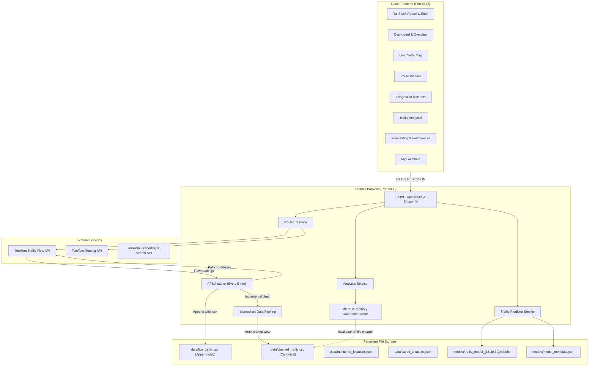
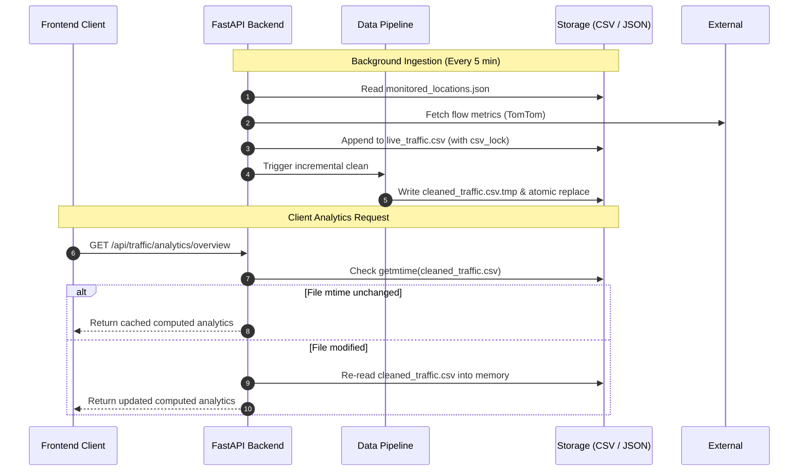

# TrafficWatch Architecture & Design Specification

This document provides a comprehensive technical overview of the TrafficWatch architecture, subsystem interactions, concurrency models, data flows, and design principles.

---

## 1. System Overview

TrafficWatch is designed as a decoupled, full-stack smart-mobility platform combining:
- High-throughput asynchronous REST services (FastAPI)
- Automated background data ingestion (APScheduler)
- Resilient time-series data cleaning and normalization (Data Pipeline)
- Multi-horizon traffic forecasting with strict chronological validation (scikit-learn ML Subsystem)
- Interactive, responsive web client (React 19, TypeScript, TanStack Router, Leaflet, Recharts)

---

## 2. Core Subsystems

### 2.1 Backend API & Ingestion Engine (`main.py`)

- **Framework**: FastAPI with Uvicorn ASGI server.
- **Lifespan Management**: An `APScheduler` background scheduler starts automatically with the FastAPI lifespan context manager. It manages:
  1. A 5-minute recurring job querying TomTom Traffic Flow for every coordinate in `data/monitored_locations.json`.
  2. An immediate cold-start poll 2 seconds after server initialization.
  3. Clean shutdown semantics releasing thread pools without blocking process termination.
- **Graceful Degradation**: If `TOMTOM_API_KEY` is omitted, the scheduler logs an informational notice and pauses polling without crashing the server. All historical analytics, saved location operations, and offline model forecasts remain operational.

### 2.2 Concurrency & File Safety Guarantees

Because TrafficWatch operates without requiring an external SQL database server, file-based persistence is engineered with rigorous thread safety:

1. **`threading.Lock()` Protection**:
   - `csv_lock`: Protects write operations to `data/live_traffic.csv`.
   - `saved_locations_lock`: Protects read/write operations to `data/saved_locations.json`.
   - `_pipeline_lock`: Serializes dataset cleaning and deduplication passes.
2. **Atomic Write Replacement**:
   - The data pipeline writes cleaned records to a `.tmp` file and replaces the destination using `os.replace()`, guaranteeing POSIX/Windows atomic file-swapping. Concurrent readers never observe partially written files.
3. **Mtime-Based In-Memory Caching**:
   - The analytics service caches parsed pandas DataFrames in memory and checks the operating system `os.path.getmtime()` on every request. Data is re-parsed only when the underlying CSV has been modified on disk.

---

## 3. Data Pipeline Subsystem (`services/data_pipeline.py`)

The data pipeline processes raw TomTom telemetry through five distinct stages:

1. **Preservation**: `data/live_traffic.csv` is strictly append-only. Raw observations are never purged.
2. **Field Validation**: Verifies ISO 8601 timestamps, reasonable coordinate bounds ($[-90, 90]$, $[-180, 180]$), non-negative travel times, and speed values.
3. **Spatial Normalization**: Standardizes city names (e.g., mapping subdistrict variations to canonical city identifiers like Pune, Mumbai, Delhi).
4. **Two-Stage Deduplication**:
   - *Exact deduplication*: Drops identical raw records.
   - *Logical deduplication*: Uses composite key `(location_key, timestamp_truncated_to_minute)` to resolve multiple readings for the same road segment within a 60-second window.
5. **Conflict Resolution**: When conflicting readings exist within the same window, records with higher TomTom confidence scores are retained.

---

## 4. Machine Learning & Predictive Subsystem (`ml/`)

### 4.1 Prediction Formulation

The forecasting engine predicts traffic congestion residuals $\Delta_{t+h}$ across three distinct planning horizons:
- **15 Minutes** ($h = 15$)
- **30 Minutes** ($h = 30$)
- **60 Minutes** ($h = 60$)

$$\Delta_{t+h} = \text{Congestion}_{t+h} - \text{Congestion}_t$$
$$\widehat{\text{Congestion}}_{t+h} = \text{Congestion}_t + \widehat{\Delta}_{t+h}$$

Forecasting residual delta rather than raw percentage bounds the problem space and forces candidate models to predict change relative to prevailing corridor inertia.

### 4.2 Feature Engineering (`ml/data_prep.py`)

- **Current State**: `current_congestion_percent`, `current_speed_kmh`, `free_flow_speed_kmh`, `speed_ratio`, `free_flow_gap`.
- **Temporal & Cyclical**: `hour`, `dayofweek`, `is_weekend`, $\sin(2\pi \cdot \text{hour} / 24)$, $\cos(2\pi \cdot \text{hour} / 24)$, $\sin(2\pi \cdot \text{dow} / 7)$, $\cos(2\pi \cdot \text{dow} / 7)$.
- **Corridor Momentum**: `prior_congestion`, `prior_speed`, `cong_trend`, `speed_trend` computed strictly from antecedent observations within each corridor.

### 4.3 Lookahead Prevention & Chronological Validation

Standard random $K$-fold cross-validation causes catastrophic data leakage in time-series problems by training on future records to predict the past. TrafficWatch enforces:

- **Strict Chronological 3-Way Split**:
  - Train: First 60% of timeline.
  - Validation: Subsequent 20% of timeline.
  - Held-out Test: Final 20% of timeline.
- **Embargo Boundaries**: A minimum 60-minute temporal buffer isolates train, validation, and test partitions to eliminate overlapping target horizon windows.
- **Identical Evaluation Samples**: All candidate models (Persistence, Historical Average, Random Forest, HistGradientBoosting, Ridge) are scored against the exact same held-out test records.

### 4.4 Model Selection & Baseline Optimality

During validation benchmarking:
- On 15-minute, 30-minute, and 60-minute horizons, the **Persistence Baseline** ($\widehat{\Delta} = 0$, meaning future conditions equal current conditions) achieved the lowest test Mean Absolute Error (**3.97%** on 15m, **4.18%** on 30m, **3.36%** on 60m).
- Complex tree models (Random Forest, HistGradientBoosting) tended to overfit to short-term micro-fluctuations in historical flow, yielding higher test MAEs (6.63% to 6.84%).
- In accordance with empirical machine learning best practices, TrafficWatch deploys the Persistence model for active serving while providing complete transparency in candidate benchmarks.

---

## 5. Routing Subsystem (`services/routing_service.py`)

The routing engine bridges user route planning with TomTom's Routing API v1:
- Computes up to 3 alternative routes between arbitrary coordinates.
- Retrieves live traffic delay (`trafficDelayInSeconds`) and free-flow travel time (`noTrafficTravelTimeInSeconds`).
- Computes normalized congestion percentage:
  $$\text{Congestion } \% = \min\left(100, \max\left(0, \frac{\text{Delay}}{\text{Free-flow Time} + \text{Delay}} \times 100\right)\right)$$
- Supports ranking preferences:
  - `fastest`: Sorted by total travel time including traffic.
  - `shortest`: Sorted by physical distance in kilometers.
  - `least-congested`: Sorted by relative traffic delay ratio.

---

## 6. Frontend Architecture (`fronted/src/`)

- **Runtime & Bundler**: Vite 8 with Bun.
- **Routing**: `@tanstack/react-router` providing type-safe, file-based routing.
- **State Management**: `@tanstack/react-query` for query caching, background polling, and optimistic updates.
- **Mapping**: Leaflet 1.9 and `react-leaflet` 5.0 with custom vector markers and styled polyline overlays.
- **Data Visualization**: Recharts for interactive line charts, bar comparisons, and hourly/day-of-week heatmaps.
- **Styling**: Tailwind CSS 4 with accessible Radix UI primitives.
