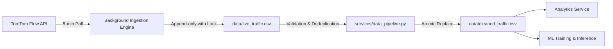

# TrafficWatch Data Pipeline Specification

This document details how traffic data is acquired, validated, cleaned, stored, and served within the TrafficWatch ecosystem.

---

## 1. Overview & Data Flow

TrafficWatch employs a dual-tier storage strategy designed for high integrity and traceability:

1. **Raw Tier (`data/live_traffic.csv`)**: Append-only log of raw responses received from TomTom's Traffic Flow API. Data is never deleted or modified in this tier.
2. **Cleaned Canonical Tier (`data/cleaned_traffic.csv`)**: Deduplicated, normalized, and validated dataset used by all downstream services (Analytics, ML training, Predictions API).

---

## 2. Ingestion Mechanism

- **Trigger**: `APScheduler` background job executing every 5 minutes inside the FastAPI lifespan context.
- **Source**: Monitored coordinates loaded dynamically from `data/monitored_locations.json`.
- **API Endpoint**: TomTom Traffic Flow API v4 (`https://api.tomtom.com/traffic/services/4/flowSegmentData/absolute/10/json`).
- **Resilience**: If the external API request fails or times out, the error is logged and the cycle completes without halting the application.

---

## 3. Dataset Schemas

Both raw and cleaned datasets adhere to the following 11 canonical columns:

| Column Name | Type | Description | Example |
| :--- | :--- | :--- | :--- |
| `timestamp` | String (ISO 8601) | Timestamp with timezone offset of when reading was captured. | `2026-10-15T08:49:27+05:30` |
| `city` | String | Standardized city name (`Pune`, `Mumbai`, `New Delhi`). | `Pune` |
| `area` | String | Descriptive neighborhood, corridor, or road name. | `Central Pune` |
| `latitude` | Float | Geographic latitude of road segment midpoint. | `18.5204` |
| `longitude` | Float | Geographic longitude of road segment midpoint. | `73.8567` |
| `current_speed_kmh` | Float | Current estimated traffic speed in km/h. | `24.0` |
| `free_flow_speed_kmh` | Float | Uncongested speed limit / free-flow speed in km/h. | `40.0` |
| `current_travel_time_seconds` | Integer | Estimated travel time across road segment. | `360` |
| `free_flow_travel_time_seconds`| Integer | Expected free-flow travel time across segment. | `216` |
| `confidence` | Float | TomTom measurement reliability score ($[0.0, 1.0]$). | `0.85` |
| `congestion_percent` | Float | Delay ratio: $\max\left(0, \frac{\text{Delay}}{\text{Current Time}} \times 100\right)$. | `40.0` |

---

## 4. Cleaning & Validation Rules

The pipeline enforces strict data quality guards implemented in `services/data_pipeline.py`:

### Field Validation
- `timestamp`: Must be a valid parseable datetime string.
- `latitude` / `longitude`: Must fall within $[-90.0, 90.0]$ and $[-180.0, 180.0]$.
- `current_speed_kmh` / `free_flow_speed_kmh`: Must be numeric and $\ge 0$.
- `current_travel_time_seconds`: Must be $\ge 0$.
- `free_flow_travel_time_seconds`: Must be $> 0$ (avoids division by zero in delay calculations).
- `confidence`: Clamped to range $[0.0, 1.0]$.
- `congestion_percent`: Clamped to range $[0.0, 100.0]$.

### Spatial Normalization
City names are normalized using alias matching (e.g., mapping `"Mulshi Subdistrict"` or `"Pune City"` to canonical `"Pune"`).

### Two-Stage Deduplication
1. **Exact Deduplication**: Identical row hashes are eliminated.
2. **Logical Deduplication**: Readings from the same spatial entity within the same minute are collapsed using the composite key:
   $$\text{Key} = \left(\text{latitude}, \text{longitude}, \text{timestamp}[:16]\right)$$
3. **Conflict Resolution**: If two readings share the same minute key but present divergent speeds ($>0.5\text{ km/h}$) or congestion ($>1.0\%$), the record possessing the higher TomTom confidence score is retained.

---

## 5. Atomic Storage & Concurrency Control

File updates are protected against race conditions using:
- **`threading.Lock()`**: Prevents interleaved writes from concurrent threads.
- **Atomic Renaming**: The pipeline writes cleaned output to `data/cleaned_traffic.csv.tmp` and executes an atomic replacement via `os.replace()`. Readers never encounter half-written files.
- **Mtime Cache**: Downstream analytics services inspect file modification timestamps to avoid re-reading disk blocks when data has not changed.

---

## 6. Pipeline Maintenance Endpoints

| Method | Endpoint | Description |
| :--- | :--- | :--- |
| `POST` | `/api/traffic/collect` | Triggers an immediate traffic poll of all monitored locations. |
| `POST` | `/api/traffic/clean` | Triggers a full, idempotent validation and deduplication pass on `live_traffic.csv`. |
| `GET` | `/api/traffic/collector/status` | Reports scheduler health, running status, and last collection timestamp. |
| `GET` | `/api/traffic/predictions/data-status` | Reports sample count, corridor readiness, and data freshness. |

---

## 7. Dataset Bootstrapping & Portability

- A pre-collected snapshot of `data/cleaned_traffic.csv` (~144 KB) is included in the repository.
- This allows any new contributor to clone the repository and immediately run all analytics, predictions, dashboards, and test suites without waiting hours to accumulate live data.
- **Regenerating Clean Data**: Running `POST /api/traffic/clean` or calling `clean_historical_dataset()` idempotently rebuilds `data/cleaned_traffic.csv` directly from `data/live_traffic.csv`.
- **Starting Fresh**: To reset traffic history, truncate `data/live_traffic.csv` and `data/cleaned_traffic.csv` to their header rows.
